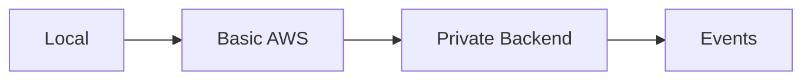

# AWS TypeScript Workshop

This repo is now organized as a staged workshop, not just a final implementation.

It has three jobs:

- preserve the reference map to previous workshops
- hold the shared TypeScript app code
- teach the architecture through explicit infrastructure stages

## What Is In Here

- `frontend/`: static TypeScript frontend for the local app
- `services/bff/`: public BFF service plus final-stage Lambda container scaffold
- `services/backend/`: private backend plus queue worker and Lambda scaffolds
- `services/webhook/`: final-stage webhook Lambda scaffold
- `packages/shared/`: shared domain logic, adapter contracts, and stage wiring
- `data/`: local file-backed board state and queue seed data
- `final-stage-spec.md`: target architecture for the final AWS stage
- `STAGE-0.md`: local-stage commands and demo notes
- `infra-basic/`: first public AWS deployment
- `infra-private/`: private-backend AWS deployment
- `infra-events/`: evented AWS deployment
- `tutorial.md`: stage-by-stage workshop walkthrough
- `workshop-infra.md`: notes on the staged infrastructure layout
- `images/architecture-diagrams.md`: workshop diagrams

## Current App Shape

The implementation follows the workshop direction we talked through:

- frontend
- public BFF
- private backend
- asynchronous external events through a queue
- retry and chaos hooks

For the local stage:

- board state is stored in files
- the queue is simulated with JSON files
- the backend worker polls the local queue

For the AWS stages:

- `infra-basic` introduces a public BFF and public backend with DynamoDB persistence
- `infra-private` moves the backend behind internal HTTP
- `infra-events` adds webhook ingestion, SQS, DLQ, and a worker
- stage-specific adapters are selected by wiring modules rather than duplicating the app

## Quick Start

```bash
npm run build
npm run reset:data
npm run test:local
npm run start:local
```

Then open `http://127.0.0.1:7070`.

`test:local` verifies the compiled local board and queue logic without opening ports, which keeps it runnable in restricted environments.

## Workshop Stages



- Stage 0: local app and local queue simulation
- Stage 1: `infra-basic/` for the first cloud deployment
- Stage 2: `infra-private/` for the public-BFF/private-backend shape
- Stage 3: `infra-events/` for webhook ingestion and queueing

Start with [tutorial.md](/Users/adam/para/projects/aws-typescript-workshop/tutorial.md) and [images/architecture-diagrams.md](/Users/adam/para/projects/aws-typescript-workshop/images/architecture-diagrams.md).

## Reference Material

### GCP Python workshop

Source workshop content:
- `/Users/adam/sandbox/workshops/gcp-intro-python`
- `/Users/adam/sandbox/workshops/gcp-intro-python/README.md`
- `/Users/adam/sandbox/workshops/gcp-intro-python/tutorial.md`
- Older Python Pulumi recording: `https://www.youtube.com/watch?v=_AHrGMMXgM4`

Why it matters:
- Clean small-scope workshop structure
- Good progression from simple storage to app deployment
- Useful model for pacing two demos in one session

Likely reusable ideas:
- Intro flow and prerequisites section
- Agenda shape
- Demo sequencing
- End-of-workshop resources slide

### GCP workshop slides

iA Presenter deck:
- `/Users/adam/para/projects/gcp-workshop/presentation/slides.iapresenter`
- `/Users/adam/para/projects/gcp-workshop/presentation/slides.iapresenter/text.md`
- `/Users/adam/para/projects/gcp-workshop/presentation/slides.iapresenter/info.json`
- Recording: `https://www.youtube.com/watch?v=WNiBPJz3mKA`
- Exported deck: `/Users/adam/para/projects/gcp-workshop/presentation/slides.pdf`
- Reference deck: `/Users/adam/para/projects/gcp-workshop/presentation/reference-gcp-python-slides.pdf`
- Reference notes: `/Users/adam/para/projects/gcp-workshop/presentation/reference-gcp-python-slides.txt`

Why it matters:
- Best local example of the slide format used for a recent workshop
- Gives us a concrete deck structure to adapt for the AWS TypeScript version

Notable structure in that deck:
- Title slide with presenters
- Housekeeping
- Agenda
- Brief Pulumi intro
- Demo sections
- Resource slide
- Closing slide

### Azure Container Apps workshop

Source workshop content:
- `/Users/adam/sandbox/workshops/az-aca-multi-service`
- `/Users/adam/sandbox/workshops/az-aca-multi-service/README.md`
- `/Users/adam/sandbox/workshops/az-aca-multi-service/workshop-infra.md`
- Recording: `https://www.youtube.com/watch?v=yTRPd39oN7A`

Why it matters:
- Strong example of a workshop built around progressive architecture stages
- Good reference for "local -> cloud -> more advanced pattern" storytelling
- Useful for platform and application framing, even though the target cloud is different

Notable pieces:
- `infra-basic/` for the first cloud deployment
- `infra-native/` for production-hardening patterns
- `infra-dapr/` for event-driven extension patterns
- `images/architecture-diagrams.md` for slide-ready architecture explanations

### Azure Dapr/Event-driven material

Additional Dapr-focused references:
- `/Users/adam/sandbox/workshops/az-aca-multi-service/infra-dapr/README.md`
- `/Users/adam/sandbox/workshops/az-aca-multi-service/infra-dapr/Program.cs`
- `/Users/adam/sandbox/todo-demo/infra-dapr`

Why it matters:
- Good reference if the AWS workshop needs an advanced extension section
- Useful for comparing when to introduce messaging/event patterns versus keeping the core workshop simpler

### AWS Python workshop

Source workshop content:
- `/Users/adam/sandbox/workshops/aws-intro-python`
- `/Users/adam/sandbox/workshops/aws-intro-python/README.md`
- `/Users/adam/sandbox/workshops/aws-intro-python/demo.md`
- `/Users/adam/sandbox/workshops/aws-intro-python/app.py`
- `/Users/adam/sandbox/workshops/aws-intro-python/Dockerfile`

Related media and references:
- Older Python Pulumi recording: `https://www.youtube.com/watch?v=_AHrGMMXgM4`
- Reference deck: `/Users/adam/para/projects/gcp-workshop/presentation/reference-aws-python-slides.pdf`
- Reference notes: `/Users/adam/para/projects/gcp-workshop/presentation/reference-aws-python-slides.txt`

Why it matters:
- This is the most direct predecessor for the new AWS TypeScript workshop
- Covers the same shape: bucket, app, Lambda, API Gateway
- Useful for deciding what to keep versus what to modernize in TypeScript

## Current Direction

The working implementation is intentionally split between:

- Stage 0: a local version that demonstrates the architecture and the async flow without AWS dependencies
- staged AWS infrastructure folders that each teach one architectural move

The direct influences are still:

- GCP workshop for pacing and slide structure
- Azure multi-service workshop for the staged architecture story
- AWS Python workshop for the Lambda-container baseline

## Workshop Prep

See [WORKSHOP-TODO.md](/Users/adam/para/projects/aws-typescript-workshop/WORKSHOP-TODO.md) for the live prep checklist and dry-run plan.
